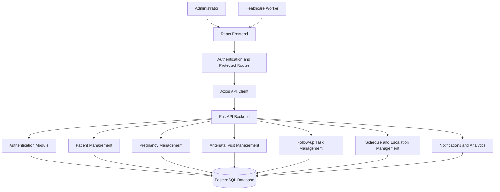

#  MatriCare AI
### Closing the Maternal Care Follow-up Loop

**MatriCare AI** is a full-stack maternal healthcare management platform designed to improve continuity of care through structured patient management, pregnancy tracking, antenatal visit records, follow-up task management, escalation workflows, and real-time operational visibility.

The platform connects healthcare administrators and healthcare workers through dedicated role-based workspaces, helping organize maternal healthcare activities and reduce gaps in follow-up coordination.

<p align="center">
  <a href="https://github.com/parthakhare1812/MatriCare-AI">
    
  </a>
  
  
  
  
</p>

---

## 📌 Table of Contents

- [Overview](#-overview)
- [Problem Statement](#-problem-statement)
- [Project Objectives](#-project-objectives)
- [Key Features](#-key-features)
- [User Roles](#-user-roles)
- [Application Modules](#-application-modules)
- [Technology Stack](#-technology-stack)
- [System Architecture](#-system-architecture)
- [Project Structure](#-project-structure)
- [Database and Backend Architecture](#-database-and-backend-architecture)
- [API Documentation](#-api-documentation)
- [Getting Started](#-getting-started)
- [Environment Configuration](#-environment-configuration)
- [Running the Application](#-running-the-application)
- [Testing](#-testing)
- [Security Considerations](#-security-considerations)
- [Future Enhancements](#-future-enhancements)
- [Contributing](#-contributing)
- [Author](#-author)

---

## 🌍 Overview

Maternal healthcare requires continuous monitoring, timely antenatal visits, structured follow-ups, and coordination between healthcare workers and administrators.

However, fragmented records, missed follow-up activities, delayed escalations, and limited operational visibility can create gaps in maternal care delivery.

**MatriCare AI aims to address these challenges through a centralized digital maternal healthcare management system.**

The platform provides:

- Centralized maternal patient records.
- Pregnancy registration and tracking.
- Antenatal care visit management.
- Follow-up task assignment and tracking.
- Care scheduling and monitoring.
- Escalation management.
- Notification management.
- Administrative dashboards and analytics.
- Role-based access control.
- Audit log visibility.

The central objective is to help healthcare teams maintain better visibility into maternal care activities and follow-up responsibilities.

## 🎯 Problem Statement

Maternal healthcare workflows involve multiple interconnected activities that need to be tracked consistently.

Some common operational challenges include:

1. **Fragmented Patient Records:** Maternal patient information may be maintained across disconnected records.
2. **Missed Follow-ups:** Healthcare workers need a structured way to identify and manage pending or missed follow-up activities.
3. **Limited Pregnancy Tracking:** Pregnancy information and antenatal care records need to remain connected.
4. **Delayed Escalations:** Unresolved follow-up tasks may require escalation and acknowledgement.
5. **Limited Administrative Visibility:** Administrators need centralized information about facilities, healthcare workers, patient activity, and follow-up performance.
6. **Communication Gaps:** Healthcare teams need notification mechanisms to stay informed about relevant activities.

MatriCare AI brings these workflows together in one platform.

## 🎯 Project Objectives

- Digitize maternal patient and pregnancy management.
- Organize antenatal visit records.
- Improve follow-up task coordination.
- Provide visibility into overdue and pending activities.
- Support structured escalation workflows.
- Enable administrators to monitor healthcare operations.
- Maintain role-based access to application functionality.
- Provide a scalable foundation for future maternal healthcare enhancements.

---

## ✨ Key Features

### 🔐 1. Authentication and Role-Based Access

- Secure user authentication.
- JWT-based authentication.
- Protected application routes.
- Role-based workspace access.
- Authenticated user profile retrieval.
- Session management and logout.

### 🛠️ 2. Administrative Workspace

The Admin workspace provides centralized operational visibility.

Features include:

- Administrative dashboard.
- Maternal patient management.
- Pregnancy records overview.
- Antenatal visit monitoring.
- Healthcare worker management.
- Healthcare facility management.
- Follow-up task monitoring.
- Escalation monitoring.
- Notification management.
- Audit log visibility.
- Administrative profile and settings.

### 👩‍⚕️ 3. Healthcare Worker Workspace

Healthcare workers receive a dedicated workspace for managing maternal care activities.

Features include:

- Personal dashboard.
- Assigned patient management.
- Patient registration and updates.
- Pregnancy registration and tracking.
- Antenatal visit registration and updates.
- Follow-up task creation and management.
- Care schedule.
- Escalation acknowledgement and resolution.
- Notification management.
- Assigned facility information.
- Worker profile and settings.

### 🤰 4. Maternal Patient Management

- Register maternal patients.
- View patient information.
- Search and manage patient records.
- Update patient information.
- Deactivate patient records.
- Associate pregnancy records with patients.

### 🍼 5. Pregnancy Management

- Register pregnancy records.
- Maintain Last Menstrual Period (LMP).
- Track Estimated Due Date (EDD).
- Monitor pregnancy status.
- Retrieve pregnancy details.
- Update pregnancy information.

### 🩺 6. Antenatal Care Management

- Register antenatal visits.
- Associate visits with pregnancy records.
- Record visit dates and types.
- Maintain clinical notes.
- Schedule next follow-up dates.
- Track follow-up status.
- Retrieve and update visit records.

### 📋 7. Follow-up Task Management

A central component of MatriCare AI is structured follow-up task management.

Features include:

- Create follow-up tasks.
- Associate tasks with pregnancy records.
- Optionally associate tasks with antenatal visits.
- Assign tasks to healthcare workers.
- Set due dates.
- Track task status.
- Update task information.
- Monitor pending and missed tasks.
- Track completed activities.

### 📅 8. Care Schedule

The Care Schedule brings together relevant maternal care activities.

It provides visibility into:

- Antenatal visits.
- Follow-up tasks.
- Scheduled activities.
- Due dates.
- Activity status.

### 🚨 9. Escalation Management

The escalation workflow supports visibility and action on unresolved follow-up activities.

Features include:

- View escalations.
- Monitor escalation status.
- View escalation details.
- Acknowledge escalations.
- Resolve escalations.
- Track escalation timestamps.

### 🔔 10. Notification Management

- View notifications.
- Track unread notifications.
- Mark individual notifications as read.
- Mark all notifications as read.
- View notification details.

### 📊 11. Dashboard and Analytics

The platform provides operational dashboards with information such as:

- Total maternal patients.
- Ongoing pregnancies.
- Antenatal visits.
- Pending follow-up tasks.
- Upcoming follow-ups.
- Overdue follow-ups.
- Open escalations.
- Unread notifications.
- Follow-up activity trends.
- Facility performance information.

### 📝 12. Audit Logs

Administrative audit log functionality provides visibility into recorded system activities and supports operational accountability.

---

## 👥 User Roles

MatriCare AI currently supports two primary application roles.

| Role | Responsibilities |
|---|---|
| Administrator | Monitor platform operations, manage facilities and healthcare workers, view patient and pregnancy records, monitor follow-ups, escalations, notifications, and audit logs. |
| Healthcare Worker | Manage assigned patients, pregnancies, antenatal visits, follow-up tasks, care schedules, escalations, and notifications. |

Each role receives a dedicated workspace with protected routes and role-appropriate functionality.

---

## 🧰 Technology Stack

### Frontend

| Technology | Purpose |
|---|---|
| React | Component-based user interface |
| TypeScript | Type safety and maintainable frontend development |
| Vite | Development server and build tooling |
| Tailwind CSS v4 | Utility-first styling |
| React Router DOM | Application routing |
| Axios | HTTP communication with backend |
| TanStack React Query | Server-state management and data fetching |
| Recharts | Dashboard charts and visualizations |
| Lucide React | Interface icons |
| Sonner | Toast notifications |

### Backend

| Technology | Purpose |
|---|---|
| Python | Backend programming language |
| FastAPI | REST API framework |
| SQLAlchemy 2.x | Database ORM |
| PostgreSQL | Relational database |
| Psycopg 3 | PostgreSQL database connectivity |
| Pydantic | Data validation and serialization |
| Pydantic Settings | Application configuration |
| Alembic | Database migrations |
| JWT | Token-based authentication |
| Uvicorn | ASGI application server |

### Development and Testing

- Git and GitHub
- npm
- Python virtual environments
- Pytest
- ESLint
- TypeScript compiler
- Swagger / OpenAPI documentation

---

## 🏗️ System Architecture

MatriCare AI follows a modular full-stack architecture.



### Architecture Overview

**Frontend Layer**
- React and TypeScript application.
- Role-based routing.
- Reusable UI components.
- API service layer.
- Query-based server-state management.

**Backend Layer**
- FastAPI application.
- Modular API endpoints.
- Service and repository layers.
- Pydantic schemas.
- Authentication and authorization.
- Database transaction management.

**Database Layer**
- PostgreSQL relational database.
- SQLAlchemy models.
- Alembic migration management.

---

## 📂 Project Structure

The repository is organized into separate frontend and backend applications.

```text
MatriCare-AI/
│
├── README.md
│
├── backend/
│   ├── app/
│   │   ├── api/
│   │   │   └── v1/
│   │   │       └── endpoints/
│   │   │
│   │   ├── core/
│   │   ├── db/
│   │   ├── models/
│   │   ├── repositories/
│   │   ├── schemas/
│   │   ├── services/
│   │   └── main.py
│   │
│   ├── alembic/
│   ├── tests/
│   ├── alembic.ini
│   └── requirements.txt
│
└── frontend/
    ├── public/
    ├── src/
    │   ├── components/
    │   │   ├── shared/
    │   │   └── ui/
    │   │
    │   ├── context/
    │   ├── hooks/
    │   ├── layouts/
    │   ├── lib/
    │   ├── pages/
    │   │   ├── admin/
    │   │   └── worker/
    │   │
    │   ├── services/
    │   ├── types/
    │   ├── App.tsx
    │   ├── main.tsx
    │   └── index.css
    │
    ├── package.json
    ├── vite.config.ts
    └── index.html
```

*Note: This is a high-level representation of the application structure. Individual files and supporting modules may evolve as development continues.*

---

## 🗄️ Database and Backend Architecture

MatriCare AI uses PostgreSQL as its relational database.

SQLAlchemy provides ORM-based database operations, while Alembic manages schema migrations.

The backend follows a modular architecture with the following responsibilities:

| Layer | Responsibility |
|---|---|
| API Endpoints | Handle HTTP requests and responses |
| Schemas | Validate request data and serialize responses |
| Services | Implement business logic |
| Repositories | Perform database queries and persistence |
| Models | Define database entities and relationships |
| Core | Application configuration and shared functionality |

### Major Data Domains

- Users and authentication.
- Healthcare worker profiles.
- Healthcare facilities.
- Facility assignments.
- Maternal patients.
- Pregnancy records.
- Antenatal visits.
- Follow-up tasks.
- Follow-up escalations.
- Notifications.
- Audit logs.

---

## 🔗 API Documentation

MatriCare AI exposes REST APIs through FastAPI.

After starting the backend, access the interactive API documentation:

**Swagger UI**

http://127.0.0.1:8000/docs

**ReDoc**

http://127.0.0.1:8000/redoc

The API is organized under the versioned prefix:

```text
/api/v1
```

### Main API Modules

| Module | Responsibility |
|---|---|
| Authentication | Login and authenticated user information |
| Admin | Administrative operations |
| Workers | Healthcare worker operations |
| Patients | Maternal patient management |
| Pregnancies | Pregnancy records |
| Antenatal Visits | Antenatal care records |
| Follow-up Tasks | Follow-up task workflows |
| Schedule | Healthcare worker care schedule |
| Escalations | Escalation management |
| Notifications | Notification management |
| Dashboard | Operational statistics and trends |

Refer to Swagger UI for the complete endpoint list, request schemas, response schemas, and authorization requirements.

---

## 🚀 Getting Started

Follow these instructions to run MatriCare AI locally.

### 1. Prerequisites

Install the following tools:

| Requirement | Purpose |
|---|---|
| Python 3.12 | Backend runtime |
| Node.js | Frontend development runtime |
| npm | Frontend dependency management |
| PostgreSQL | Relational database |
| Git | Source code management |

You will also need access to a configured PostgreSQL database.

### 2. Clone the Repository

```bash
git clone https://github.com/parthakhare1812/MatriCare-AI.git
```

Navigate into the project:

```bash
cd MatriCare-AI
```

### 3. Backend Setup

Navigate to the backend directory:

```bash
cd backend
```

Create a Python virtual environment:

**Windows PowerShell**

```powershell
python -m venv .venv
```

Activate it:

```powershell
.\.venv\Scripts\Activate.ps1
```

Install backend dependencies:

```bash
python -m pip install -r requirements.txt
```

Configure the backend environment variables using the settings defined by the application.

Make sure your PostgreSQL database is accessible before starting the application.

### 4. Database Migrations

Run the Alembic migrations:

```bash
alembic upgrade head
```

This applies the available database migrations.

### 5. Start the Backend

Run:

```bash
python -m uvicorn app.main:app --reload
```

The backend will be available at:

```text
http://127.0.0.1:8000
```

API documentation:

```text
http://127.0.0.1:8000/docs
```

### 6. Frontend Setup

Open a new terminal and navigate to the frontend directory:

```bash
cd MatriCare-AI/frontend
```

Install dependencies:

```bash
npm install
```

Create a `.env` file in the frontend directory.

Configure the API base URL:

```env
VITE_API_BASE_URL=http://127.0.0.1:8000/api/v1
```

Start the frontend:

```bash
npm run dev
```

The frontend will be available at:

```text
http://localhost:5173
```

### 7. Access the Application

Open your browser and navigate to:

```text
http://localhost:5173
```

Make sure the backend and frontend are both running.

---

## ⚙️ Environment Configuration

### Backend

The backend uses Pydantic Settings for application configuration.

Create the backend `.env` file using the environment variable names and required settings defined in the backend configuration.

Typical configuration areas include:

- Database connection.
- JWT authentication settings.
- Application environment.
- CORS configuration.

Use the project's actual configuration definitions when setting up these values.

### Frontend

Create `frontend/.env`:

```env
VITE_API_BASE_URL=http://127.0.0.1:8000/api/v1
```

For a deployed backend, replace the local API address with the configured backend API URL.

**Important:** Never commit `.env` files, database credentials, JWT secrets, access tokens, or other sensitive configuration values to GitHub.

---

## 🧪 Testing and Validation

Quality checks are an important part of the MatriCare AI development workflow.

### Frontend Linting

```bash
npm run lint
```

### Frontend Production Build

```bash
npm run build
```

### Backend Compilation

Run from the backend directory:

```bash
python -m compileall app
```

### Backend Test Suite

Run from the backend directory:

**Windows PowerShell**

```powershell
$env:PYTHONPATH = (Get-Location).Path
python -m pytest
```

### Latest Verified Development Results

| Validation | Result |
|---|---|
| Frontend ESLint | Passed |
| Frontend TypeScript and Vite build | Passed |
| Backend compilation | Passed |
| Backend automated tests | 319 passed |
| Backend test failures | 0 |
| Local application runtime verification | Passed |

*These results represent the development verification performed during the current project milestone. They are not a substitute for production security, privacy, and clinical validation.*

---

## 🔒 Security Considerations

MatriCare AI handles workflows related to maternal healthcare. Security and privacy must remain central to its development.

The application incorporates:

- JWT-based authentication.
- Protected routes.
- Role-based authorization.
- Backend request validation.
- Structured database operations.
- Audit log functionality.

Before production deployment, additional validation is necessary, including:

- Security testing and authorization reviews.
- Secure secret and credential management.
- Database access restrictions.
- HTTPS enforcement.
- Privacy and data-protection compliance.
- Backup and recovery procedures.
- Clinical workflow validation.
- Appropriate healthcare regulatory review.

**Important:** Use synthetic or appropriately de-identified information during development and testing. Do not use real patient information in an unvalidated deployment.

MatriCare AI is a software project and is not a substitute for professional medical judgment or clinical decision-making.

---

## 🔮 Future Enhancements

Potential future development directions include:

- Advanced maternal healthcare analytics.
- Predictive identification of missed follow-up activities.
- Intelligent follow-up prioritization.
- Enhanced facility-level performance reporting.
- Automated reminder workflows.
- Expanded healthcare worker coordination.
- Multilingual interface support.
- Mobile-friendly healthcare worker workflows.
- Advanced reporting and data visualization.
- Additional integration with healthcare information systems.

These are potential enhancements and should not be interpreted as currently implemented functionality.

---

## 🤝 Contributing

Contributions, suggestions, and improvements are welcome.

To contribute:

1. Fork the repository.
2. Create a feature branch.
3. Implement your changes.
4. Run the relevant frontend and backend tests.
5. Commit your changes with a descriptive message.
6. Open a Pull Request.

Example:

```bash
git checkout -b feature/your-feature-name
git add .
git commit -m "Add: your feature description"
git push origin feature/your-feature-name
```

---

## 👨‍💻 Author

**Partha Khare**

Computer Science and Engineering Undergraduate  
VIT Bhopal University

Interested in building software systems that solve practical problems through technology, structured engineering, and thoughtful product design.

### Connect

- **GitHub:** [parthakhare1812](https://github.com/parthakhare1812)
- **LinkedIn:** [Connect on LinkedIn](https://www.linkedin.com/)

### Project Repository

[https://github.com/parthakhare1812/MatriCare-AI](https://github.com/parthakhare1812/MatriCare-AI)

---

## ⭐ Support the Project

If you find MatriCare AI interesting, consider giving the repository a ⭐ on GitHub.

Suggestions, feedback, and contributions are always welcome.

**MatriCare AI — Closing the Maternal Care Follow-up Loop.**

